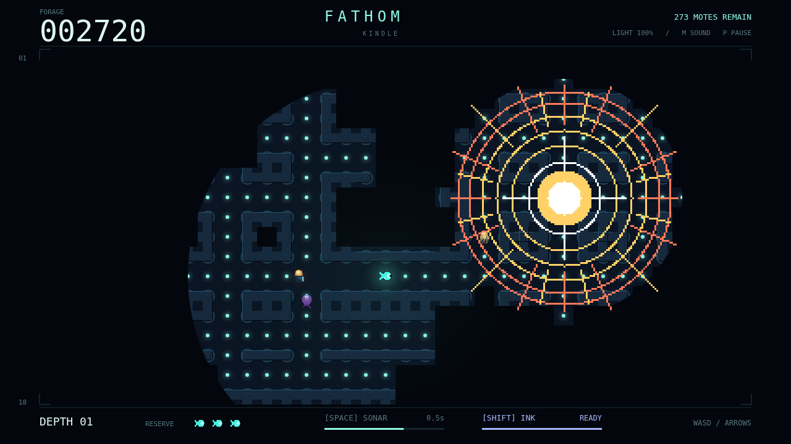

# Fathom

**Hunt in the dark.** A bioluminescent, browser-based maze chase in which knowledge is dangerous. Graze every plankton mote to descend, send sonar around blind corners, and survive three hunters that track light, sound, and flashes.

This is the **Kindle** dive: explored terrain stays remembered, but is visible only through the circular window of light you carry. Eating expands that window and attracts light-sensitive predators.



## Run locally

Use a current Node.js release supported by Vite (Node 22.18+ recommended).

```sh
npm ci
npm run dev
```

Open the local URL Vite prints. No backend, account, or external runtime service is needed. Art is bundled locally and sound is synthesized by the engine.

## Production build

```sh
npm ci
npm run build
```

Serve `dist/` with any static HTTP server, at the root or beneath a sub-path. Its `index.html` is the entry point; all runtime asset URLs are page-relative. `npm run preview` serves a local production preview.

## Controls

| Control | Action |
| --- | --- |
| Arrow keys / WASD | Swim; up/down select menu items |
| Space | Sonar pulse; confirm a menu item |
| Shift | Release ink |
| Enter | Confirm |
| Escape / P | Pause / resume |
| Escape | Back from a menu |
| M | Mute / unmute |
| Backtick | Engine telemetry overlay |
| Pointer / touch | Select and confirm menu items |

Touching the screen brings up the engine’s four-way pad, sonar and ink buttons, and menu controls.

Sonar maps corridors and marks non-amber hunters, but the Gloamfin hears it. Ink blinds the Lanternjaw and Flarefish, not the Gloamfin. Amber glimmers may be harmless bonus drifters — or a Lanternjaw in disguise. Reserve icons represent spare lives, in addition to your current attempt.

## Development and checks

```sh
npm run typecheck
npm run lint
npm run format
npm test
```

Tests run the actual Simple 2D engine against a native canvas, counted clocks, and injected input, without a browser. They cover maze invariants, screen transitions, fixed-step travel, fog, food, progression, the three hunter minds, and the debug contract.

- `src/game.ts`: engine registrations, asset loading, public state/debug type exports.
- `src/types.ts`: state and automation contracts.
- `src/world.ts`: maze, geometry, movement, graph routes, visibility, state construction.
- `src/simulation.ts`: 120 Hz render-free tick, predator minds, progression, menu/input transitions.
- `src/debug.ts`: immutable poses and JSON snapshots, accessed only via `engine.debug`.
- `src/render.ts`: sprites, fog mask, effects, menus, and HUD.

Every update creates an owned draft, integrates complete fixed ticks, carries the remainder forward, and returns a new state. Rendering never advances the world. The Simple 2D engine owns the loop, canvas fitting, input, sound, loading, diagnostics, and recording. The public debug surface installs nothing on the page.

## Showcase

`showcase/` contains the player-facing description, carousel, actual browser screenshots, and a three-second engine drawing replay. To reproduce the captures, start the development server and run:

```sh
node scripts/capture.mjs
```

The capture driver uses the project’s Playwright with Chromium’s sandbox disabled, creates its own engine, and poses the scene through the same debug surface used by tests. It is not part of the shipped runtime.
